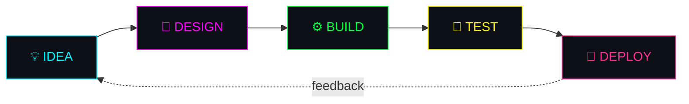

<div align="center">


</div>


## `> OPS_CENTER.live`

<div align="center">


</div>


## `> WHO_AM_I.exe`

<div align="center">


</div>

<details>
<summary><code>&gt; VIEW_RAW_RECORD</code></summary>

```yaml
name: Amirhesam
role: Automation Software Engineer // SDET
hq: Tech City, Sector 7
focus:
  - UI Automation
  - API Automation
  - Database Testing
  - CI/CD
  - Automation Frameworks
  - Web & App Development
current_stack:
  - Java
  - Selenium
  - Cucumber BDD
  - JUnit
  - REST Assured
  - SQL
  - Jenkins
  - Jira
hobbies:
  - 🎸 Music
  - 🎮 Gaming
  - 📸 Photography
status: "Always Learning..."
```

</details>


## `> TECH_CITY_DEPARTMENTS.sh`

<div align="center">


</div>

| `DEPARTMENT` | `WHAT WE BUILD` | `STATUS` |
|:--|:--|:--|
| 🌐 **Web Studio** | Landing pages, portfolios, business sites, responsive and fast | `🟢 ONLINE` |
| 💻 **Web App Lab** | Dashboards, tools, admin panels, full-stack apps with APIs and databases | `🟢 ONLINE` |
| 📱 **Mobile App Lab** | Cross-platform apps for Android and iOS | `🟢 ONLINE` |
| 🧪 **QA Automation Division** | Test frameworks, scripts, bots, CI/CD pipelines | `🟢 ONLINE` |



       

> 💬 *Need a website or app? Reach out below and let's build something.*


## `> TECH_ARSENAL`

<div align="center">

     

</div>

| | |
|:--|:--|
| `LANGUAGES` | Java · SQL · HTML5 · CSS3 |
| `AUTOMATION` | Selenium · Cucumber BDD · JUnit 5 · TestNG · Serenity · Maven · Apache POI |
| `API` | REST Assured · Postman |
| `DATA` | MySQL · Oracle · JDBC |
| `CI / CD` | Jenkins · Azure DevOps · Docker · Git · TFVC |
| `CLOUD` | AWS · Azure · Cloudflare · Raspberry Pi |
| `TOOLS` | IntelliJ IDEA · Eclipse · VS Code · Jira |
| `VISUAL` | Photoshop · Lightroom · GIMP · Corel |


## `> SYSTEM_ANALYTICS.exe`

<div align="center">

<!--COMMIT-COUNT:START-->


<!--COMMIT-COUNT:END-->


</div>


## `> PERSONAL_MODULES`

```text
[ MUSIC MODULE ]       ██████████ ONLINE  🎸
[ GAMING MODULE ]      ██████████ ONLINE  🎮
[ PHOTOGRAPHY ]        ██████████ ONLINE  📸
[ AUTOMATION ]         ██████████ ONLINE  ⚙️
[ APP & WEB BUILDER ]  ██████████ ONLINE  🌐
[ LEARNING ]           ██████████ ACTIVE  🧠
```

## `> RANDOM_TRANSMISSION`

<div align="center">


</div>


## `> OPEN_COMM_CHANNEL`

<div align="center">

[](https://amirhesamtech.com) [](https://github.com/amirh3sam) [](https://www.tiktok.com/@techwithamirh3sam)

</div>

<p align="center">
  
</p>
